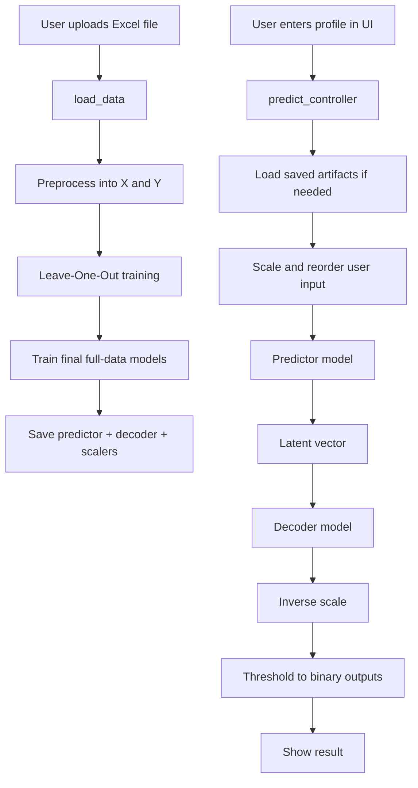
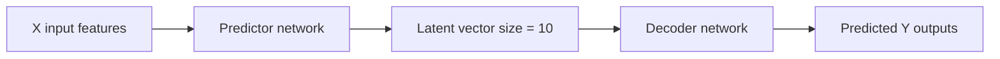
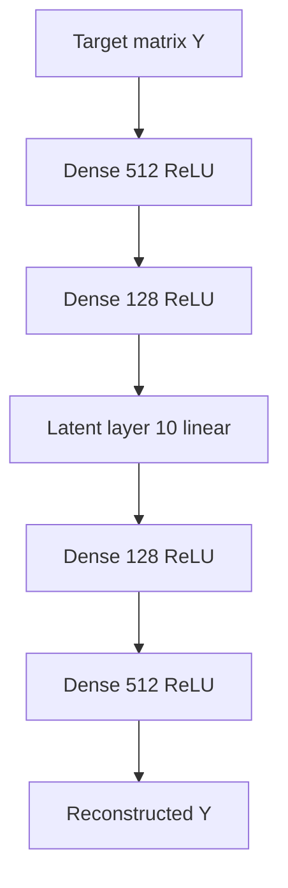
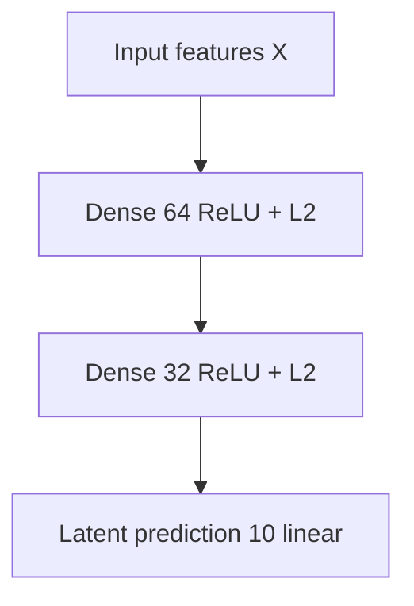

# Microbiome Prediction App: Full Flow and Model Details

## Purpose

This project trains a neural-network pipeline to predict microbiome-related outputs from a user profile.

It has two main modes:

1. **Training mode** — the user uploads an Excel file and trains the models.
2. **Prediction mode** — the user fills in a profile form and gets predicted outputs.

This document explains the full code flow, the data handling, the neural-network models, and how the saved model is reused for prediction.

---

## 1) Project files and responsibilities

### `app/ui.py`
Streamlit user interface.

It handles:
- uploading the Excel file used for training
- clicking the train button
- entering user profile values
- calling the prediction function
- displaying outputs

### `app/main.py`
Main orchestration logic.

It handles:
- loading data from Excel
- preprocessing input and target matrices
- training the models
- running Leave-One-Out validation
- saving trained artifacts
- loading saved artifacts later
- predicting outputs for one user row

### `app/loadandpreprocess.py`
Reads the Excel file and splits it into:
- `X`: input features
- `Y`: target outputs

### `app/encoder.py`
Builds the autoencoder and returns:
- `autoencoder_model`
- `encoder_model`
- `decoder_model`

### `app/predictor.py`
Builds the predictor model that maps input features into latent space.

---

## 2) High-level application flow

### Training flow

1. User uploads an Excel file in the Streamlit UI.
2. `train_controller(file_path)` is called.
3. `load_data(file_path)` reads and preprocesses the Excel file.
4. `model_training(X, Y, latent_dimension)` runs Leave-One-Out training and evaluation.
5. A final model is trained on the full dataset.
6. The trained predictor, decoder, scalers, and column metadata are saved to disk.

### Prediction flow

1. User enters a profile in the UI form.
2. `predict_controller(user_row)` is called.
3. If needed, saved models and metadata are loaded from disk.
4. The input row is cleaned, reordered, and scaled.
5. The predictor model produces a latent vector.
6. The decoder model converts that latent vector into output space.
7. The saved scaler is used to reverse scaling.
8. The outputs are thresholded to 0/1.
9. The result is shown in the UI.

---

## 3) Data preprocessing

### In `loadandpreprocess.py`

The training file is read using `pandas.read_excel()`.

The code does the following:

- Converts the `Sex` column:
  - `Male -> 1`
  - `Female -> 0`

- Extracts input features:
  - `X = df.iloc[:, 1:11]`

- Extracts target outputs:
  - `Y = df.iloc[:, 11:]`

- Binarizes the target matrix:
  - values greater than the overall mean become `1`
  - values less than or equal to the mean become `0`

So the model is not predicting raw numeric abundances. It is predicting binary target values.

---

## 4) Actual model architecture

The system uses **two neural models** working together.

### A. Autoencoder on `Y`

The autoencoder learns a compressed internal representation of the target data.

#### Encoder part
From `encoder.py`:

- Input: target dimension (`input_dim`)
- Dense layer: 512 units, ReLU
- Dense layer: 128 units, ReLU
- Latent layer: `latent_dim` units, linear

#### Decoder part
- Input: latent vector (`latent_dim`)
- Dense layer: 128 units, ReLU
- Dense layer: 512 units, ReLU
- Output layer: `input_dim` units, linear

#### Autoencoder training
The autoencoder learns to reconstruct the target matrix `Y` from itself.

Loss used:
- `huber`

---

### B. Predictor on `X`

The predictor learns to map input features into the latent space learned by the autoencoder.

From `predictor.py`:

- Input: number of feature columns in `X`
- Dense layer: 64 units, ReLU, L2 regularization
- Dense layer: 32 units, ReLU, L2 regularization
- Output layer: `latent_dim` units, linear

Loss used:
- `mse`

This means the predictor tries to match the latent vector produced by the encoder.

---

## 5) Architecture diagrams

### Full pipeline

### Neural network structure

### Autoencoder architecture

### Predictor architecture

---

## 6) Training flow inside `main.py`

### `model_training(X, Y, latent_dimension)`

This function performs Leave-One-Out Cross-Validation.

For each sample:

1. One row is held out as the test sample.
2. The remaining rows are used for training.
3. `StandardScaler` is used for `X` and `Y`.
4. The autoencoder is trained on the training `Y`.
5. The encoder produces latent vectors for the training `Y`.
6. The predictor is trained to predict those latent vectors from `X`.
7. The held-out test row is scaled and passed through the predictor.
8. The decoder converts the latent prediction back into output space.
9. The result is inverse-transformed and thresholded.
10. The prediction is stored.

After all folds:

- Overall R2 is computed
- RMSE is computed

Then a final model is trained on the full dataset so the app has a stable model for real prediction.

---

## 7) Why the final full-data model is needed

During Leave-One-Out training, each fold creates a different model.

If prediction uses only the last fold’s model, the results may be unstable.

So the code now also trains a final model on the **entire dataset** after validation.

That final model is what gets saved and reused by `predict_controller()`.

---

## 8) Saving and loading trained artifacts

### Saved files

The code saves:

- `predictor.keras`
- `decoder.keras`
- `meta.pkl`

### What `meta.pkl` stores

- `x_scaler`
- `y_scaler`
- `feature_columns`
- `target_columns`

### Why this matters

When the app is restarted, the saved model and metadata allow prediction without retraining.

---

## 9) Prediction flow in `predict_controller()`

For a single user row:

1. Make a copy of the input dataframe.
2. Remove `Name` if it exists.
3. Convert `Sex` from text to number if needed.
4. Reorder columns to match the training feature order.
5. Scale the row using the saved `x_scaler`.
6. Feed the scaled row into the predictor.
7. Feed the predicted latent vector into the decoder.
8. Reverse the scaling using `y_scaler`.
9. Convert probabilities/values to binary using a threshold of `0.5`.
10. Return a dataframe if target column names are available.

---

## 10) Prediction debug prints

The current code includes debug prints that show:

- reordered input columns
- reordered input values
- scaled input values
- latent predicted vector
- decoder raw output
- inverse-transformed output
- final binary output

These help identify whether the issue is:
- input mismatch
- scaling problem
- weak predictor output
- decoder output collapse

---

## 11) Streamlit UI flow

### Training section

The UI:

- accepts an Excel file upload
- saves it temporarily
- calls `train_controller(temp_path)` when the Train button is clicked
- displays training metrics

### Prediction section

The UI:

- collects a single user profile
- creates a one-row dataframe
- calls `predict_controller(user_row)`
- displays the returned prediction

---

## 12) Important practical observations from the code

### A. The target is binary
The current `Y` is binarized in preprocessing.

That means the final output should also be binary.

### B. Scaling matters
The model uses `StandardScaler` for both `X` and `Y`.

If the input order or values are wrong, prediction quality drops quickly.

### C. Column names must match
The prediction row must match the exact feature columns used in training.

### D. Save/load consistency matters
The saved model and the saved scalers must belong to the same trained run.

---

## 13) Plain-English summary

The app works like this:

- It learns patterns from a training spreadsheet.
- It compresses the microbiome outputs into a small hidden code.
- It learns how to predict that code from a person’s profile.
- It then expands the code back into predicted outputs.
- The saved model is reused later for fast prediction.

---

## 14) File map summary

- `app/ui.py` — user interface
- `app/main.py` — training, saving, loading, prediction flow
- `app/loadandpreprocess.py` — Excel loading and data preparation
- `app/encoder.py` — autoencoder and decoder creation
- `app/predictor.py` — predictor network creation

---

## 15) Final one-line explanation

This project uses one neural network to learn a hidden microbiome code and another neural network to predict that code from a person’s profile, then uses a decoder to convert that code back into final microbiome predictions.
